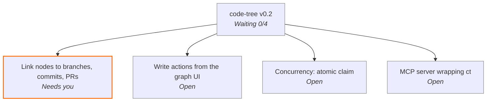

# code-tree graph

_Generated by `ct` at 2026-11-22 14:23:22. Do not edit; source of truth is `.tree/nodes/*.md`. Protocol: `.tree/PROTOCOL.md`._

Edges point from a node to what it waits on. `unblocks` = unresolved nodes above it.

## Next

| state | id | title | unblocks | head |
|---|---|---|---|---|
| Needs you | `link-nodes-to-branches-commits-prs` | Link nodes to branches, commits, PRs | 1 | code-tree v0.2 |
| Open | `write-actions-from-the-graph-ui` | Write actions from the graph UI | 1 | code-tree v0.2 |
| Open | `concurrency-atomic-claim` | Concurrency: atomic claim | 1 | code-tree v0.2 |
| Open | `mcp-server-wrapping-ct` | MCP server wrapping ct | 1 | code-tree v0.2 |

## Code sync

Last `ct sync`: `7eb90085` in `.` at 2026-11-22 14:23:10.

## HEAD `code-tree-v0-2` — code-tree v0.2 · 5 nodes · Waiting 0/4

| id | state | title | waits on | blocks | unblocks | mode · agent | touches | outcome |
|---|---|---|---|---|---|---|---|---|
| `code-tree-v0-2` | Waiting 0/4 | code-tree v0.2 | link-nodes-to-branches-commits-prs, write-actions-from-the-graph-ui, concurrency-atomic-claim, mcp-server-wrapping-ct | — | 0 | discuss |  |  |
| `link-nodes-to-branches-commits-prs` | Needs you | Link nodes to branches, commits, PRs | — | code-tree-v0-2 | 1 | discuss |  |  |
| `write-actions-from-the-graph-ui` | Open | Write actions from the graph UI | — | code-tree-v0-2 | 1 | build |  |  |
| `concurrency-atomic-claim` | Open | Concurrency: atomic claim | — | code-tree-v0-2 | 1 | build |  |  |
| `mcp-server-wrapping-ct` | Open | MCP server wrapping ct | — | code-tree-v0-2 | 1 | build |  |  |

